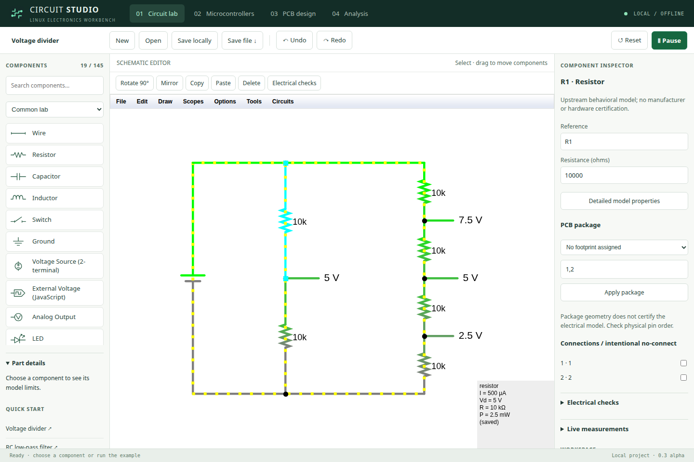

# Circuit Studio

An integrated, offline Linux electronics workbench with schematic simulation, AVR and PIC firmware execution, and a PCB editor sharing one project file.

**Status: working alpha, 0.4.0-alpha.10.** This is an independent application built with open-source simulation engines. It is not affiliated with Proteus, does not import Proteus projects, and does not yet offer Proteus feature parity.



## Workspace navigation

The workbench uses a neutral slate/white interface with blue action controls.
Both editors have a visible **Pan** tool, zoom buttons, a zoom readout and **Fit**.
Hold **Space and drag**, or drag with the **middle mouse button**, to temporarily
pan without changing the selected component or unfinished route. **H** selects
Pan, **V** selects editing, **F** fits, and **+ / −** zoom. **Pan steps** or
**Shift + arrow keys** move the view without dragging. Text fields retain normal typing.

**Find command** (Ctrl+K) searches common actions and all workspaces, including Coding Hub.
**Library** and **Inspector** remember panel visibility; **Reset layout** restores both.
The mode label follows keyboard tool changes. The Linux menu and window use the same
slate/blue icon as the header. See the [research and checks](docs/planning/UX-ALPHA6.md).
Action bars wrap
at narrow widths; advanced engine menus remain available. Panning leaves circuit
geometry, PCB connectivity, undo history and the running MCU timeline unchanged.

## Oscilloscope and instruments

Choose **Oscilloscope** above the schematic or **View in oscilloscope** in the
component inspector. The scope toolbar exposes Run/Pause, time zoom, Properties,
and CSV/image export. **Logic & instruments** opens shared firmware captures with
grouped signal/timebase/trigger controls, voltage scaling, cursors, capture status
and a guided setup. The peripheral lab stays available below the waveform.
See the [instrument guide and research](docs/INSTRUMENTS.md).

## Roadmap progress

**29 of 29 original ticket acceptance gates are complete.** Alpha.4 adds a wired
UART/I²C/SPI peripheral lab, reusable hierarchical snapshots and assembly variants,
constrained PCB routing, four-layer via spans, and checked output jobs. The MCU
feasibility audits now have repeatable AVR/8052/STM32/ESP32-C3 probes and explicit
integration decisions; they do **not** add supported device profiles.
See [the acceptance record and scope limits](docs/planning/MILESTONE-29.md) and
[the lab guide](docs/LAB_GUIDE.md). Completing these bounded tickets does not establish
full Proteus parity.

## Circuit assistant

Click **Coding Hub → Start circuit chat** in the Circuit lab toolbar.
Studio prepares a separate copy and opens a ready-to-use Coding Hub workspace in
your browser. Describe your circuit or changes, choose your configured model,
enable **Allow edits & commands**, and send. No paths, copied setup instructions
or extra plugin configuration are required. Coding Hub must be installed.

When the assistant finishes, return to Studio: **Check for result → Bring into
editor**. The result must be saved as `design.circuit`. Undo restores the previous
circuit. If you changed the original in the meantime, Studio blocks replacement;
use **Save edited copy** to keep the assistant result separately. Starting another
chat creates another copy. Opening a workspace alone does not invoke a model.
Keep the Studio window open for this handoff; the saved copies remain in the app's
`assistant` data folder even after closing it.

Coding Hub also has **New circuit** and **Open circuit in Studio** buttons. Its
previous draft is preserved. This is a dedicated handoff to Coding Hub, not an
embedded model or live synchronization of unsaved editor state.


## Run on Linux

```sh
./run.sh
```

Requires Python 3.10+. Full desktop archives include Electron/Chromium; source checkouts use installed Chrome or Chromium. The included PIC and ngspice backends are built for Linux x86-64 / Ubuntu 24.04; rebuild PICsim and install system ngspice on other architectures. The launcher opens a dedicated desktop window and serves the application only on `127.0.0.1`. Internet access is not needed at runtime.

Install a verified, relocatable application:

```sh
python3 install.py
```

The installer keeps projects and recovery profiles outside versioned application files. Uninstall preserves user projects. See [offline installation and release packaging](docs/INSTALLATION.md).

For a regular browser window: `./run.sh --serve`, then open the printed local address. Change the port with `--port NUMBER` if necessary.

## What works

- **Circuit lab:** 146 searchable component entries with categories/favorites and explicit model limits, unit-aware property inspector, component references, navigable electrical checks, placement, wiring, rotate/mirror, copy/paste, cross-workspace undo/redo, analog and digital simulation, oscilloscope views, example circuits, measurements and SVG export. CircuitJS1 supplies the simulation and schematic engine.
- **Firmware:** eight lab profiles: Arduino Uno R3, classic Nano, bare ATmega328P, PIC16F84A, PIC16F628A, PIC16F877A, PIC18F4520 and PIC18F4550. Load compiled Intel HEX, run, pause, reset and step; inspect GPIO, registers and program counter. AVR USART0 output appears in the serial monitor. Each profile includes blink and button-to-LED exercises with source; ADC-capable devices also include a voltage-sweep exercise.
- **Circuit connections:** AVR GPIO uses `D0`–`D13` and `A0`–`A5`; PIC signals follow the selected chip’s pin reference. External Voltage components receive outputs; labeled `IN_` nodes supply inputs. Analog sliders provide 0–5 V test stimuli, overridden by a connected schematic node. Classic Nano A6/A7 are analog-only. Physical pin references and manufacturer links help translate an exercise to hardware.
- **PCB:** assign DIP/SOIC/header/passive packages and pin maps, rotate/flip footprints, use two/four-layer stacks and explicit via spans, preview schematic updates while preserving placement and unaffected routes, route front/back tracks with bend points and through vias, fill solid copper pours with clearance, inspect physical same-net intersections, run shared export checks, and export KiCad boards or Gerber/drill ZIPs.
- **Reuse and assembly:** snapshot circuit blocks with private named nets, nested instance paths, explicit parent ports and stable PCB identities. Assembly variants export DNP/procurement-value BOMs while retaining copper and simulation.
- **Peripheral lab:** shared-time UART/I²C/SPI transactions, EEPROM readback, LCD character view and OLED display RAM; open the wired example from Instruments.
- **Projects:** v2 `.circuit` files retain stable component/pin/net identities, schematic, firmware per profile, selected device, PCB layout and analysis results. v1 projects migrate on opening. Save locally uses atomic disk writes with a previous revision; browser recovery retains two checked revisions. Open also accepts CircuitJS text/XML circuits. Use Save file for a portable backup; local disk projects are under `$XDG_DATA_HOME/circuit-studio/projects/`.

- **Analysis:** standalone ngspice DC/AC/transient sweeps, first-probe plots, CSV export and local diode/BJT model import with explicit syntax limits. Matching ngspice source and licenses are included.

- **3D:** interactive board preview, glTF/STL export and mechanical origin manifest. Board/drill geometry follows the PCB; package bodies are approximate envelopes.
- **Coding Hub / automation:** transactional JSON plans, actual-engine analog simulation, SVG/KiCad export, optimistic revision checks, project-scoped `codehub circuit` integration and an optional MCP stdio adapter. See [automation setup and examples](docs/AUTOMATION.md).

**Milestone delivered:** [29 original acceptance gates](docs/planning/MILESTONE-29.md),
including feasibility decisions. The original backlog is closed within its recorded
scope; the application remains an alpha with the boundaries below.

The [professional-workbench roadmap](docs/planning/ROADMAP.md) compares this alpha with documented Proteus workflows and includes a component/UI specification and dependency-ordered backlog. The latest placement repair lets you select an op-amp or other component and **click empty canvas space to place it**; dragging still sets size, and wires require a drag between endpoints.

See [the lab guide](docs/LAB_GUIDE.md) for device choices, exercises, source files and physical wiring references.

## Current boundaries

- Firmware offers legacy independent timing or a shared timeline with timestamped output edges and sampled analog feedback. GPIO/PWM/RC/ADC fixtures pass, but feedback has exchange-interval latency and instruction quantization. The wired peripheral lab validates bit-banged I²C/SPI return paths and GPIO UART, with the behavioral limits in the acceptance record.
- MCU support is limited to the eight profiles listed above (six distinct chip models). Uno, Nano and bare ATmega328P share the same AVR core. AT89S52/8051, ATmega32/2560, ESP32 and STM32 are not implemented. An AVR C editor/debugger uses an installed AVR-GCC toolchain. PIC compilation/debugging remains external; supplied examples can be rebuilt with AVR-GCC/gputils.
- Profiles use 5 V logic and fixed clocks (16 MHz AVR, 4 MHz PIC). Legacy connectors assume power/reset; on-schematic MCU packages require explicit supply/reset wiring. Shared mode models generic strong/weak/high-Z drivers and PIC16 RA4 open-drain behavior. It does not model chip-specific electrical limits, oscillator waveforms, fuse-dependent clocks, USB or PIC hardware serial monitoring. The protocol instruments are behavioral subsets, not electrically characterized device packages.
- Automated device checks cover blink, button GPIO, ADC reference points and project persistence. They do not certify all silicon peripherals, interrupts, instruction edge cases or arbitrary firmware. Pin references describe exposed signals, not a complete power/oscillator wiring diagram.
- Basic two-pin parts receive generic packages automatically; other components require an explicit package/pad map. The behavioral 555 has a default DIP-8 mapping. Generic symbols/models do not certify manufacturer pinouts or electrical behavior.
- PCB uses a fixed 100 × 60 mm board and 0.5 mm tracks. Pad sizes/drills follow assigned packages. DIP-28/40 are the wide 15.24 mm variants; exact narrow/manufacturer variants must be verified or added. Two/four-layer routing, bounded shove, constrained pairs, length tuning and through/blind/microvia spans are supported. Thermal reliefs, general autorouting, courtyards and arbitrary HDI stackups are not.
- Design checks cover physical copper connectivity across intersections/vias/pours, layer access, copper/pad clearance and board edges. Checks do not cover every manufacturing or assembly constraint. Both KiCad and Gerber UI exports require the available checks to pass. Verify footprint pitch, polarity and fabrication outputs before ordering.
- Schematic changes do not automatically rewrite an existing PCB. Export rejects a board whose imported netlist no longer matches the schematic; Update from schematic previews changes and retains placement/routes whose endpoint nets still match.
- There is no Proteus `.dsn` / `.pdsprj` compatibility or general-purpose vendor SPICE model import. The experimental Analysis tab accepts a limited local D/NPN/PNP syntax and does not translate the schematic.

## Build from source

Install Node.js 22+, npm, Python 3, GCC and Make. Then:

```sh
npm ci
npm run build
npm test
npm run test:engine
```

To rebuild the lab examples, install `gputils`, `gcc-avr`, `binutils-avr` and `avr-libc`, then run `npm run build:examples` before `npm run build`. CI rebuilds these examples before testing them.

The build bundles AVR8js and the Gerber ZIP writer, builds the vendored TypeScript simulation engine and compiles the PIC backend. The first engine build installs its locked development dependencies. `CHROME_BIN=/path/to/chromium npm test` selects a different Chromium binary.

The runnable `web/` assets and `native/libcircuitpic.so` are included for convenience. All corresponding source is included under `web/*-source.js`, `native/`, `sources/`, and the Python files. See [ARCHITECTURE.md](ARCHITECTURE.md), [VALIDATION.md](VALIDATION.md), and [THIRD_PARTY_NOTICES.md](THIRD_PARTY_NOTICES.md).

After updating an existing installation, save your project and close/reopen Circuit Studio so the Python backend and frontend use the same version.

## License

GPL-2.0-or-later. Third-party code retains its own notices. See [LICENSE](LICENSE) and [THIRD_PARTY_NOTICES.md](THIRD_PARTY_NOTICES.md).

Drawing guide: [snap grid, automatic wire bends and junctions](docs/DRAWING.md).
