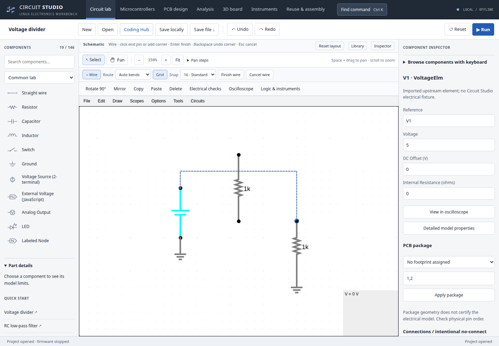

# Drawing circuits

In **Circuit lab**, the drawing row sits above the component-editing controls.

1. Choose **Wire** or press **W** with the canvas focused. **Auto bends** is the
   default. A blue ring identifies the snapped destination pin or wire.
2. Click the first pin, move to the destination, then click its pin. The dashed
   preview follows a right-angle route around component bodies. Dragging between
   endpoints also works.
3. To guide a route, click empty grid points for intermediate corners. **Backspace**
   removes the last corner. **Enter** or **Finish wire** finishes a dangling wire
   at the preview endpoint. Double-clicking an empty point also finishes there.
4. **Escape**, **Cancel wire**, or a right-click cancels unfinished wiring. A
   preview does not change the circuit or saved project. Completed wires remain
   available for Undo/Redo, and the wire tool stays active for the next connection.
   An import or another command that changes circuit geometry cancels a stale preview.

Clicking an existing wire deliberately creates a branch junction. Merely crossing
a wire does not connect it; use visible junction dots and electrical checks to
confirm the intended connection. Routed wires follow attached component pins when
the component body is dragged. Existing straight-wire editing remains available:
choose **Straight drag** in Route, or **Straight wire** in the component library.

**Grid** toggles the dots without changing the circuit. **Snap** selects the
standard 16-unit or finer 8-unit editor grid for new edits; it does not reposition
existing parts. Pins are snapped to their exact coordinates, including imported
fine-grid parts. The dot spacing adapts when zoomed out to avoid visual clutter;
the selected snap interval is unchanged. Grid visibility and the routing-style
preference are remembered locally. Snap spacing follows the schematic's existing
grid setting.

Space-drag and middle-drag still pan during an unfinished route. Zoom and fit
remain available. Search **Draw a wire** or **Show or hide grid** with Ctrl+K.

## Implementation and limits

This uses CircuitJS's existing orthogonal wire router and routed-wire format,
with a new preview/commit interaction and canvas-space grid. Routes, identities,
and connectivity survive a normal Circuit Studio project save/reopen. Routing
work is bounded for responsiveness; when no clear route is found, the preview
asks for a corner rather than silently drawing an obstructed fallback. Complex
or unusually large schematics may need intermediate corners. Straight-line
legacy wires keep their existing movement behavior. This is not a claim of
Proteus routing parity or PCB autorouting.

The workflow is informed by [Labcenter's wiring documentation](https://www.labcenter.com/wiring/):
two-pin placement, intermediate corners and automatic rerouting. Regression tests
exercise real mouse/keyboard gestures, solver voltage and net identities,
intentional branches versus crossings, component dragging, exact fine-grid pins,
cancel, pan, undo/redo, serialization and responsive controls.
