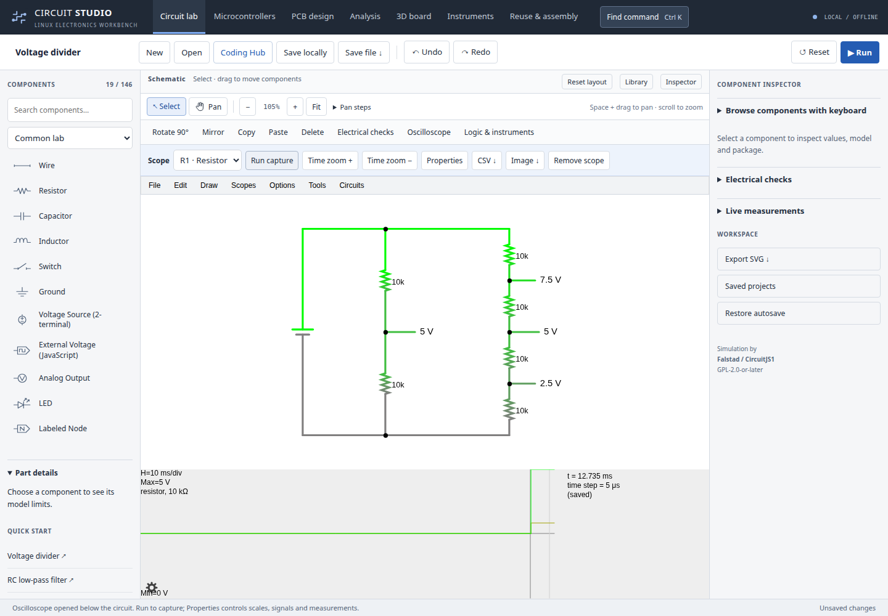
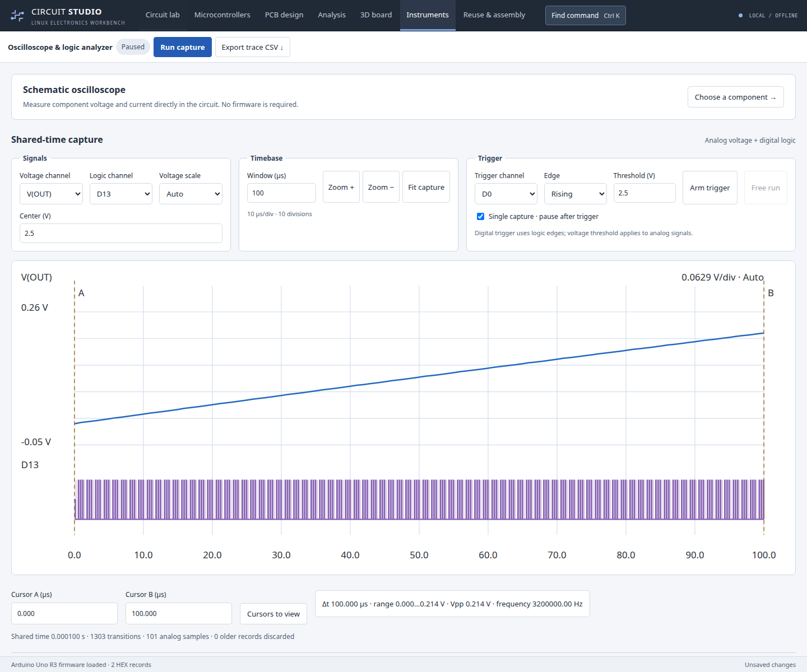

# Oscilloscope and instrument workflow

## Circuit voltage and current

1. In **Circuit lab**, choose **Oscilloscope** above the canvas. Search by reference or component name, choose a signal, and select **Open scope**. The component inspector also offers **View in oscilloscope**.
2. The waveform appears below the schematic. Use **Run capture / Pause capture** in its toolbar. Pure analog circuits do not require firmware.
3. Use **Time zoom + / −** to change the visible time span. **Properties** exposes automatic/manual voltage scales, voltage/current plots, trigger, frequency/RMS/average and other measurements supported by the engine. Existing right-click controls remain available.
4. Choose an active scope to adjust or export it. **CSV** exports the engine's displayed min/max samples; **Image** offers waveform export formats. Opening the same signal again reuses its docked scope. **Remove scope** removes only that scope, leaving the circuit intact.

## Aligned firmware voltage and logic

Open **Logic & instruments** above the schematic, the **Instruments** workspace, or search for “logic analyzer” with **Ctrl+K**.

Use the setup button to choose **Shared timeline** and load firmware in Microcontrollers. The powered MCU example is an optional starting point; opening it follows the existing project-replacement prompt. Label schematic nodes to create voltage channels. MCU GPIO channels appear after the first shared step/run. Independent firmware execution does not create a shared capture, and the page explains this instead of starting an empty acquisition.

- **Signals:** select voltage and logic channels. Voltage can scale automatically or use a chosen V/div and center voltage. The plot clips an out-of-range voltage to the display area; raw capture data remains intact.
- **Timebase:** set the full window in microseconds, use Zoom +/−, or Fit capture. The grid has ten horizontal divisions and five voltage divisions.
- **Trigger:** select the signal and rising/falling edge. Threshold applies to analog voltage channels. Arm, then run. With Single capture enabled, the shared simulation pauses after the post-trigger half-window. Running again rearms a completed trigger. Free run clears the trigger without deleting samples.
- **Cursors:** click the plot alternately for A/B, enter their times, or choose Cursors to view. Read Δt, voltage range, peak-to-peak voltage, and logic frequency. Frequency needs at least two qualifying rising edges between the cursors.
- **Export:** trace CSV retains analog records and digital transitions on the shared timebase. The button is disabled until data exists. The capture badge distinguishes no capture, capturing, waiting for trigger, paused, and triggered/paused.

The **Protocol & peripheral lab** remains below the waveform as an expandable section, including UART/SPI/I²C, EEPROM, LCD/OLED views and pin assignments.

## Research and verification

[Tektronix's systems-and-controls primer](https://www.tek.com/en/documents/primer/oscilloscope-systems-and-controls) separates vertical, horizontal and trigger controls. This informed the grouping, division readouts and voltage-scale controls. [Keysight's run-control guidance](https://helpfiles.keysight.com/Standalone_BenchVueSoftware_PW_HelpFiles/PWScopeApp/Content/GUI/Instrument%20Settings/Instrument%20Run%20Control.htm) informed explicit acquisition state and retaining captured waveforms when paused. These are interface references, not claims of equivalent instrument accuracy or features.

Browser tests cover scope creation/reuse/removal without geometry edits, properties and CSV access, empty-state guidance, responsive instrument layouts, actual AVR/PIC shared captures, deterministic trigger stop, cursor conversion, manual scale, zoom/fit, invalid time windows and unchanged recorded samples during display adjustments. Existing simulation, PCB, firmware and peripheral regressions remain required.

The schematic scope uses the existing CircuitJS timestep sampler. Shared voltage traces use the configured exchange interval; GPIO events retain backend instruction-completion timestamps. The latter retains at most 200,000 transitions and 20,000 frames across the first 64 labeled voltage nodes. A single capture pauses the simulated circuit and firmware together. This release improves the existing instrument workflows; it does not add hardware instrument connections or Proteus-equivalent instrument coverage.
