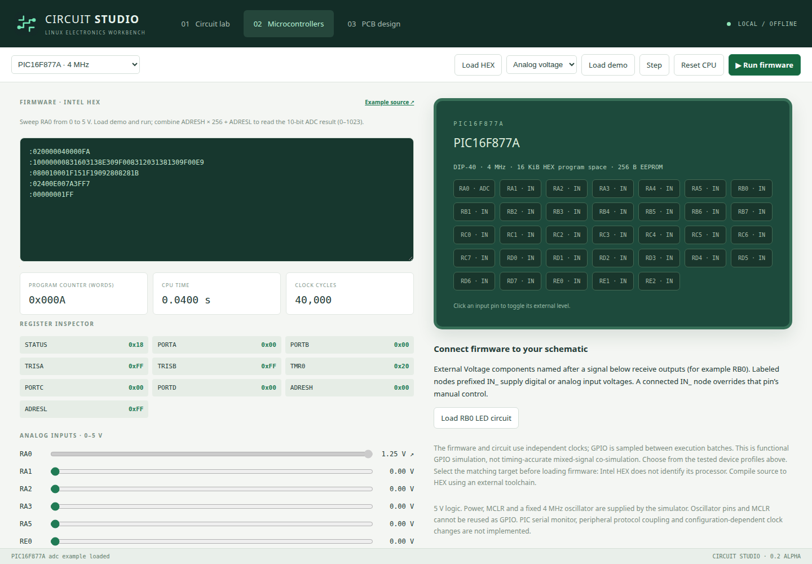
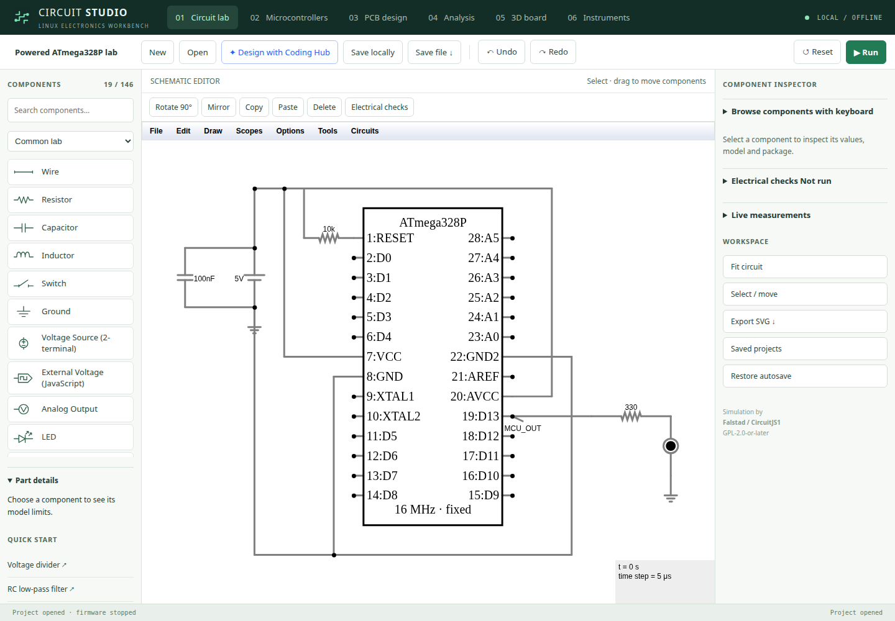

# Microcontroller lab

Circuit Studio 0.4 includes eight selectable profiles backed by six chip models. Uno, classic Nano and bare ATmega328P run the same AVR core with different exposed pins. The PIC choices run their actual PICsim processor models rather than a renamed generic CPU.

| Profile | Simulated oscillator | Exposed signals | Analog inputs | Included exercises |
|---|---|---|---|---|
| Arduino Uno R3 | 16 MHz | D0–D13, A0–A5 | A0–A5 | Blink, button, ADC |
| Arduino Nano classic | 16 MHz | D0–D13, A0–A7 | A0–A7; A6/A7 analog-only | Blink, button, ADC; extra A7 source |
| ATmega328P DIP-28 | 16 MHz | D0–D13, A0–A5, with physical DIP references | A0–A5 | Blink, button, ADC |
| PIC16F84A DIP-18 | 4 MHz | RA0–RA4, RB0–RB7 | None | Blink, button |
| PIC16F628A DIP-18 | 4 MHz | RA0–RA4, RB0–RB7 | None | Blink, button |
| PIC16F877A DIP-40 | 4 MHz | Ports A–E except oscillator/reset pins | AN0–AN7 | Blink, button, ADC |
| PIC18F4520 DIP-40 | 4 MHz | Ports A–E except oscillator/reset pins | AN0–AN12 | Blink, button, ADC |
| PIC18F4550 DIP-40 | 4 MHz | Ports A–E except oscillator/reset pins and VUSB; RC4/5 input-only | AN0–AN12 | Blink, button, ADC |

Legacy connector-based profiles assume 5 V logic, powered chips, reset released and the fixed oscillator listed above. The new on-schematic package requires explicit supply and reset wiring. These are firmware simulation profiles, not USB programmers or physical board connections. The app does not flash hardware.



## First LED exercise

1. Open **Microcontrollers** and choose the board or chip.
2. Select **LED blink**, then **Load demo**.
3. Click **Load D13 LED circuit** (AVR) or **Load RB0 LED circuit** (PIC).
4. Click **Run firmware**. The output pin changes and the schematic resistor/LED carries current. Switch to **Circuit lab** to view the circuit, or pause and single-step the program.

For **Button → LED**, use the same LED circuit and load the button example. Toggle D2 (AVR) or RB1 (PIC) to change the LED output. For circuit-driven inputs, add a node label `IN_D2` or `IN_RB1`; a connected node overrides the manual pin button.

## Analog exercise

Select an ADC-capable chip, choose **Analog voltage**, load the demo and run. Move the A0 (AVR) or RA0 (PIC) slider. Read the result as `ADCH × 256 + ADCL` for AVR or `ADRESH × 256 + ADRESL` for PIC. With a 5 V reference, 0 V is 0, midpoint is about 511–512, and 5 V is 1023.

Alternatively, attach a node label `IN_A0` or `IN_RA0` to a voltage source in Circuit lab. The input control shows the circuit voltage with an arrow and disables manual adjustment while connected. Values entering the ADC bridge are clamped to 0–5 V. This does not model damage from overvoltage.

Classic Nano also provides analog-only A6 and A7. `examples/lab/nano-adc7.c` and its HEX file demonstrate A7; these pins deliberately have no digital GPIO buttons.

## Use your own firmware

Choose the exact target before loading Intel HEX. HEX does not encode the processor model, so a valid checksum and memory range cannot prove that a program was compiled for the right chip. Configure the compiler for the oscillator shown above. PIC examples disable the watchdog and low-voltage programming and initialize digital/analog modes explicitly.

The **Example source** link opens the source for the selected lab exercise. All sources and HEX files are in `examples/lab`. Rebuild with `npm run build:examples`, using AVR-GCC/avr-libc/binutils-avr and gputils installed externally; `npm run build` copies them into the offline app. The build script supports `GPASM`, `GPASM_INCLUDE`, `AVR_GCC` and `AVR_OBJCOPY` environment variables for non-system installations.

Save a `.circuit` file to retain the schematic, all profile firmware, selected target and board. CPU registers, runtime EEPROM, input button levels and slider settings are reset when switching profiles or reopening a project. Existing version-1 project files remain readable.

## Wiring reference and scope

The **Pin reference & hardware connections** panel maps each exposed signal to the selected package pin or board header. It does not replace a complete hardware schematic. The ATmega328P DIP profile uses Arduino-style signal names in the simulation bridge and shows PB/PC/PD functions and physical pin numbers in the reference.

Manufacturer references: [Arduino Nano pinout](https://docs.arduino.cc/resources/pinouts/A000005-full-pinout.pdf), [ATmega328P](https://www.microchip.com/en-us/product/atmega328p), [PIC16F84A](https://www.microchip.com/en-us/product/pic16f84a), [PIC16F628A](https://www.microchip.com/en-us/product/pic16f628a), [PIC16F877A](https://www.microchip.com/en-us/product/pic16f877a), [PIC18F4520](https://www.microchip.com/en-us/product/pic18f4520), [PIC18F4550](https://www.microchip.com/en-us/product/pic18f4550).

These models have automated blink/button/ADC checks, not complete peripheral certification. PIC USB and the PIC serial monitor are not connected. SPI/I2C peripherals and physical programming remain unfinished. Independent timing retains the original ideal-voltage connector bridge. Shared timing adds the bounded GPIO model and synchronized instruments described below. Use the supported-device list as the boundary; 8051, ATmega32/2560, ESP32 and STM32 are not implemented.

## Shared timeline and scope exercise

1. Open **Microcontrollers**, choose Uno, and load the LED circuit and blink demo.
2. Choose **Shared timeline** and an exchange interval. Use 1 µs for short-pulse
   work; larger intervals speed slow demonstrations at the cost of input/analog
   sampling resolution. PIC shared mode can be substantially slower than legacy.
3. Run briefly, pause, then open **Instruments**. Digital channels are named after
   pins. Add a labeled node in Circuit lab to create its `V(label)` voltage channel.
4. Choose the logic/voltage channels and a time window in microseconds. Select a
   trigger channel and edge, press **Arm trigger**, then **Run / pause firmware**.
   **Pause after trigger** stops at the first exchange boundary after half of the
   selected window has elapsed following the trigger. Arm again for a new capture.
5. Click the plot twice to place A/B cursors, or type their times. Read Δt, voltage
   range and rising-edge frequency. **Export trace CSV** includes integer ticks,
   seconds, channel, value and record kind. Gray plot space is not captured data.

The automated fast-toggle exercise retains more than 10,000 edges, compares the
complete analog trace with deliberately stalled rendering, and checks a real
PWM → RC → ADC path (`tests/coupled.cjs`). Each tick is 0.5 ns, but that timestamp
resolution is not an electrical accuracy claim. GPIO edges are quantized to
backend instruction completion; analog input feedback is sampled at the exchange
interval. Generic impedances/thresholds and capture limits are in
[the milestone notes](planning/MILESTONE-24.md).

## Place a powered MCU package

For a wired starting point, click **Open powered MCU example** in Microcontrollers.
It includes a 5 V supply, reset pull-up, decoupling capacitor and resistor/LED.
The following steps build the same kind of circuit yourself.

1. Start a blank circuit. In **Microcontrollers**, choose **ATmega328P** and click
   **Place selected MCU on schematic**. Move it with Select if needed.
2. Supply VCC pin 7 and AVCC pin 20 with 5 V; connect GND pins 8 and 22 to ground.
   Pull RESET pin 1 high, normally through a resistor. Connect D13 / physical pin
   19 through a resistor and LED to ground. Wire by the displayed physical pins.
3. The displayed 16 MHz oscillator is provided by the backend. XTAL1/XTAL2 are
   explicit reference pins; this version does not simulate an external crystal
   or derive the clock from those pins. AREF is a reference pin, not a variable
   ADC reference model; the supported ADC range is 0–5 V.
4. Select the package and use **Open attached firmware** in its inspector. Load
   firmware for that exact device, reset the CPU, then run with **Shared timeline**.
   A missing supply or asserted reset stops with a specific message. Fix the
   wiring and reset the CPU before restarting.
5. Save/reopen the `.circuit` project. Physical pin identities, selected device,
   firmware and package metadata survive. Execution starts stopped. Bare ATmega328P
   uses the new **DIP-28 narrow · 7.62 mm** footprint; verify manufacturer dimensions
   before fabrication. Uno/Nano board-module footprints are not supplied.

Only one MCU package per simulation is currently supported. Old projects using
named voltage connectors continue to open without forced conversion. Simulation
reset/power checks are not a power-consumption, brownout or damage model.



## Build and debug AVR C

Open **Microcontrollers → Write AVR C and debug source**. This supports Uno,
classic Nano and ATmega328P. It needs `gcc-avr`, `avr-libc` and `binutils-avr` on
PATH, or a toolchain directory configured with `CIRCUIT_STUDIO_AVR_BIN`. Packaged
HEX examples work without a compiler. Builds do not run project scripts.

The editor initially contains a small counter/PORTB example. Choose breakpoint
line **7**, then **Build & attach** and **Run firmware**. It stops before the PORTB
write and shows `count = 1`; resume and it stops again with `count = 2`. The analog
solver stops at the same shared time as the CPU. Setting breakpoint line 0 removes
it. Click a compiler diagnostic to select the offending source line.

Inspection reports global/static RAM bytes as unsigned values, without reconstructing
C types or stack-local variables. This is a single-file C editor with standard AVR
headers; custom includes and inline assembly are rejected. Editing source invalidates
the debug mapping. Build again after reopening a project. PIC assembly/C compilation
and PIC source debugging remain external workflows using HEX import.

## Keyboard and reproducibility

Open **Browse components with keyboard** in the inspector, choose a component with
arrow keys and press Enter. The inspector selects/centers it without a canvas click.
Tab reaches controls, visible focus outlines identify the current control, and
narrow layouts scroll to keep the library, canvas and inspector reachable.

Regression commands from the repository:

```sh
npm test
npm run test:engine
npm run test:automation
```

`tests/lab-devices.cjs` and `tests/test_devices.py` exercise the supplied firmware
profiles and blink/button/ADC cases; `tests/compiler.cjs` requires AVR-GCC and runs
in CI. `tests/usability.cjs` records the host/browser, nine effective zoom/width
combinations, a 503-component divider and bounded million-edge trace handling.
Recorded results are in `docs/evidence/usability.json`. They are software checks,
not oscilloscope measurements on physical boards or a full screen-reader audit.
